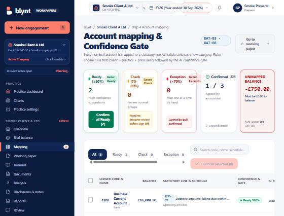
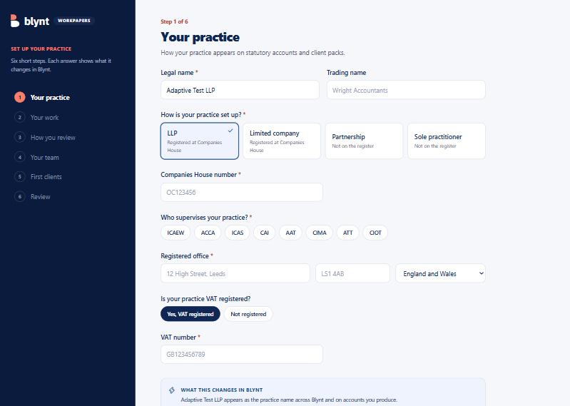
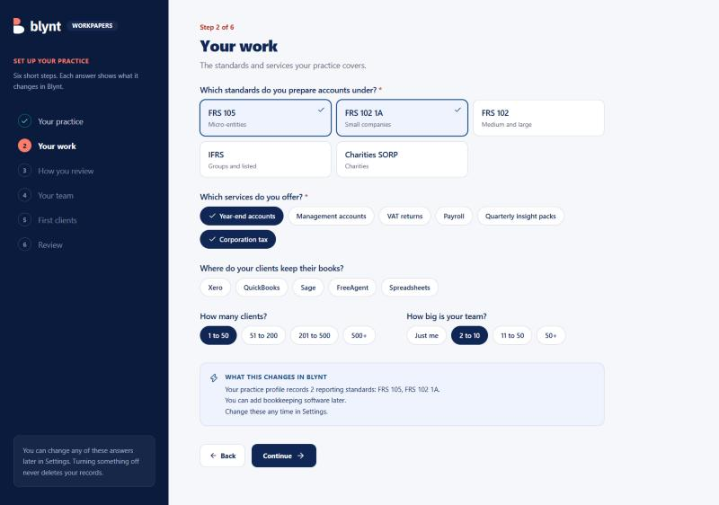
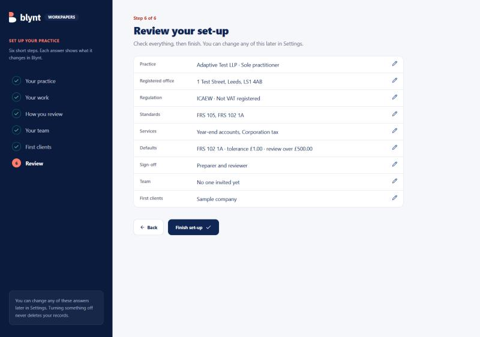
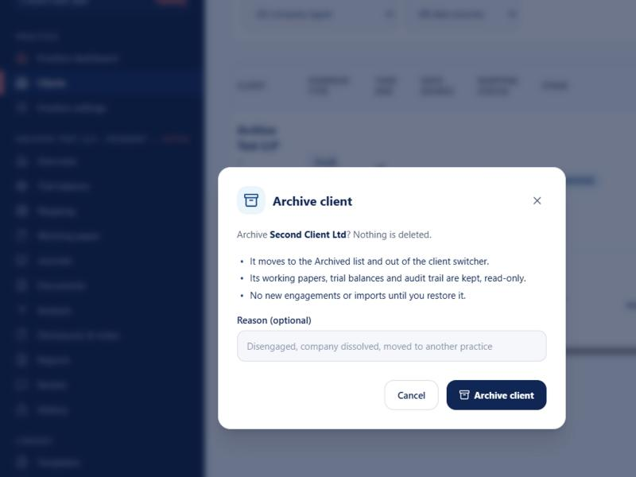
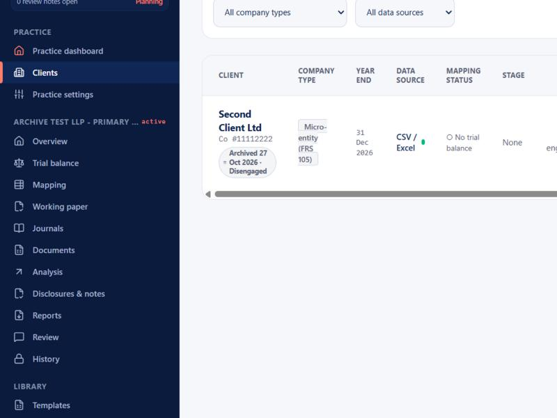
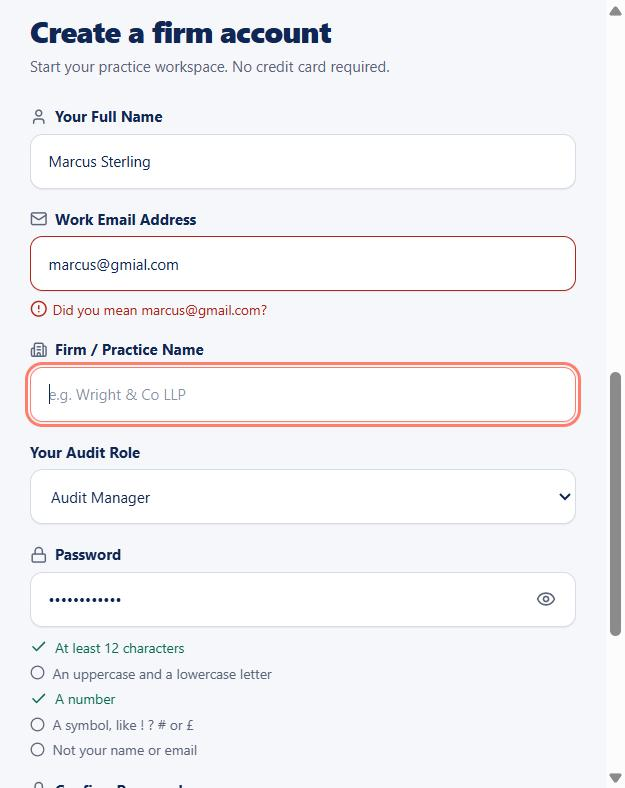

# Phase A completion report

**Working Paper Platform · Stage A: Foundations and data in (build order steps 1–4)**

Prepared October 2026 · Milestone **M1 – Data in**

---

## Summary

Phase A is complete, with one exception: the live Xero and QuickBooks connections, which need developer credentials from Xero and Intuit before they can be built.

A practice can now sign up, set itself up, invite its team, add clients, import a trial balance and get every account mapped, with each step checked, audited and tested.

| | |
|---|---|
| Build order steps delivered | 4 of 4 (step 3 without live Xero / QuickBooks) |
| "Done when" checks passed | 7 of 9 fully, 1 partly; the 2 open items both need the Xero connection |
| Automated tests | 49, all passing |
| Production build | Succeeds |
| Security fixes found and closed | 4 |
| Extra features beyond the plan | Practice set-up wizard, client archive, strong sign-up checks |

---

## What Phase A asked for, and what was delivered

The build order gives each step "Done when" checks. This is each one and how it was proven.

### Step 1 · Platform foundations

| Done when | Status | How it was proven |
|---|---|---|
| A user can be invited, set up MFA, log in and see only their assigned clients | **Done** | Automated test runs the whole journey: invite → accept → password → authenticator set-up → sign-in → sees only the assigned client. Repeated on the live server. |
| Any test write appears in the audit log and cannot be edited | **Done** | Every change records who, role, when, old value, new value and reason. Attempts to edit or delete an entry are refused, by test and on the live server. |

Delivered:

- **Sign-in** with securely hashed passwords and signed sessions; no shared or fallback passwords.
- **Two-factor sign-in (MFA)** with any authenticator app (Google, Microsoft, 1Password). Built and tested; switched off until launch, and turned on with one setting.
- **Team invites** with one-time links valid for 7 days.
- **Five roles:** preparer, reviewer, manager, partner, admin.
- **Assigned clients only:** below partner, people can be limited to the clients they work on.
- **Audit trail** that can't be changed after it's written.

### Step 2 · Clients, engagements and periods

| Done when | Status | How it was proven |
|---|---|---|
| A client and engagement can be created and the period switched from the top bar | **Done** | Created by test and on the live server; period selector in the top bar. |

Delivered:

- **Clients and engagements**, with checks that you can only create them for your own practice's clients.
- **Period selector** in the top bar.
- **Practice settings, first version**, collected by the new set-up wizard (see Extras).

### Step 3 · Trial balance import

| Done when | Status | How it was proven |
|---|---|---|
| A real client TB pulls from Xero in under 60 seconds and balances | **Not yet** | Needs the Xero connection. |
| Clicking any balance shows its transactions with a link back to Xero | **Partly** | The data structure is ready; the link needs the Xero connection. |
| A late posting in Xero is detected on refresh | **Done** (for imports) | Re-importing shows exactly which accounts moved and by how much. On the live server, a £250 late posting to account 7999 was detected. |

Delivered:

- **Trial balance upload** (CSV), which rejects a TB that doesn't balance and shows the difference.
- **A tamper-evident snapshot of every import.**
- **Change detection between imports**, listing every account that moved.

### Step 4 · Account mapping, confidence gate and rules library

| Done when | Status | How it was proven |
|---|---|---|
| Test client files map with accuracy reported from the AI log | **Done** | Accuracy is calculated from the log of every AI suggestion and its outcome. |
| A correction on one client maps the same account on the next import without review | **Done** | Correcting account 7999 once made it map automatically on the next import, for that client only. |
| The gate and rules library work through one interface that a second output type can use | **Done** | Tested with document extraction as the second type, with no changes needed. |

Delivered:

- **Mapping order:** client rules, then practice rules, then last year's mapping, then account name and code.
- **Confidence gate:** every suggestion is Ready, Check or Exception, with a reason. Auto-accept is built but off, so a person always confirms.
- **Rules library:** corrections become rules; practice-wide rules need a manager's approval.
- **AI action log:** every suggestion and outcome, which is how the 90% accuracy target is measured.
- **Smarter matching:** when an account's name and code disagree, the name wins and the account is flagged for checking. For example, "Business Current Account" on code 1200 now goes to Bank for review, not to Debtors.

---

## Extras delivered beyond the plan

### Practice set-up wizard

After sign-up, a new practice goes through six short steps: practice details, work, review defaults, team, first clients, and a final review. Questions adapt to the answers. For example, the Companies House number is only asked for LLPs and companies. Each step shows what the answers change in the app.

### Client archive

Clients the practice no longer acts for can be archived instead of deleted. Their files are kept read-only, they leave the everyday lists, and they can be restored any time. Archiving records a reason in the audit trail.

### Stronger sign-up checks

The sign-up form checks for a properly formed email, suggests corrections for typos such as "gmial.com", and requires a strong password, shown as a live checklist. The server applies the same rules.

---

## Security issues found and fixed

Testing found these problems in the existing code. All are fixed and covered by tests.

| Issue | Risk | Fix |
|---|---|---|
| Any email containing "admin" signed in as the administrator, and simple passwords like "password" were accepted | Anyone could take over the admin account | Sign-in now needs the exact email and that person's own password |
| Some trial balance and audit-log screens didn't check who was asking | A user from another practice could read them | Every engagement screen now checks practice and client access |
| Mapping changes didn't check which practice owned the account | Changes could be made across practices | Mapping now checks ownership |
| Two-factor sign-in accepted any 6 digits | MFA gave no protection | Real authenticator codes, verified on the server |

---

## Testing and quality

| Check | Result |
|---|---|
| Automated tests | 49 passing, including one per "Done when" item |
| Type checking | No errors |
| Code quality check (lint) | No errors |
| Production build | Succeeds |
| Live end-to-end run | Every Phase A journey run against the running app: sign-up, set-up, invite, access limits, audit log, import, late posting, correction-to-rule, accuracy, archive and restore |

---

## What is left

| Item | Why it's not done | What's needed |
|---|---|---|
| Live Xero and QuickBooks connection (60-second pull, links back to the ledger) | Needs developer accounts | Xero and Intuit developer apps and credentials |
| Invite emails | Links are copied and sent by hand for now | An email service |
| Logo upload and Companies House look-up in set-up | Left out rather than faked | A file-storage decision and a Companies House API key |
| Switching two-factor sign-in on | Off on request until launch | One setting (`MFA_REQUIRED=true`) |

## Next

With Phase A in place, the next stage is **Stage B: working paper core and first vertical slice** (build order steps 5–7). That covers the working paper engine, journals and the adjusted trial balance, and taking the bank schedule all the way to sign-off. It ends at milestone M2.

A developer guide covering how Phase A works, its API and configuration is in `docs/phase-a.md`.
